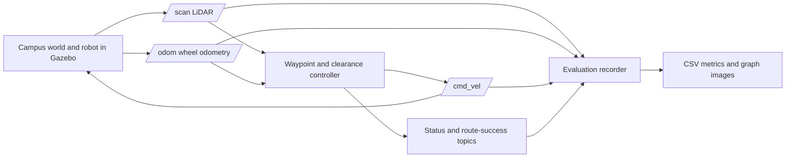

# Campus Drive AI Robotics Simulation Project Report

**Student:** Abhijit Dash 
**Programme:** B.Tech Computer Science and Engineering, 4th Year 
**Institution:** Centurion University, Bhubaneswar 
**Platform:** Ubuntu 24.04, ROS 2 Jazzy, Gazebo Harmonic (Gazebo Sim 8) 
**Project type:** Rule-based campus mobile robot simulation

## Abstract

Campus Drive AI is a simulated differential-drive robot that drives through a campus courtyard in Gazebo. A ROS 2 Jazzy controller uses wheel odometry and a planar LiDAR scan to follow nine fixed targets along an S-shaped roadmap. Three static blocks sit across the route; the waypoint path passes below the first block, above the middle block, and below the third. A local LiDAR clearance rule can turn the robot when the forward sector is close to an obstacle. An evaluator records route and sensor measurements in a CSV file, and a status sign changes from simulation started to route finished when the controller signals success.

The latest saved successful run completed with a 13.056 m odometry path in 146.62 seconds and logged 1,113 LiDAR scans. This is one recorded simulation result, not a repeated-trial average. Minimum raw range values may contain robot self-echoes and should not be presented as verified collision clearance.

## 1. Introduction and problem statement

Campus delivery and guide robots must move between destinations while sensing nearby objects. Simulation gives students a repeatable way to observe the relationship between sensors, control commands, and robot motion before any physical test. This project builds a small campus-like 3D courtyard and demonstrates waypoint following, reactive obstacle response, ROS 2 topic communication, and basic run evaluation.

The project addresses a limited prototype problem: can a simulated robot start at a marked point, follow a known route around three fixed blocks, and report completion while publishing sensor data? It does not attempt to solve general campus navigation or guarantee safe motion for arbitrary obstacles.

## 2. Objectives

1. Create a recognizable campus courtyard in Gazebo Harmonic.
2. Model a differential-drive robot with a vehicle-style body, 2D LiDAR, and odometry.
3. Bridge the simulator's sensor and control messages to ROS 2 topics.
4. Drive from the green start pad to the red finish pad using a nine-target S-shaped route around three fixed blocks.
5. Add a reactive LiDAR rule and a visible start/finish status sign.
6. Save measurable results from a successful run and present them in five labeled graphs, including simple bar charts for run time and traveled distance.

## 3. Technologies and architecture

Ubuntu 24.04 hosts ROS 2 Jazzy and Gazebo Harmonic. The world and robot are described in SDF. Python 3 with `rclpy` implements the waypoint controller, evaluation recorder, status display, and optional keyboard teleoperation. `ros_gz_bridge` connects Gazebo and ROS 2. `colcon` builds the packages using `ament_cmake`.

The launch file starts Gazebo, a ROS domain and Gazebo partition dedicated to the run, the bridge, robot spawning, autonomy, status display, and evaluation. `/scan` and `/odom` flow from Gazebo into ROS 2. The controller publishes `/cmd_vel`, which the bridge sends to the Gazebo differential-drive system. The evaluator observes sensor and command topics and writes `results/campus_evaluation.csv` after route success or when the node shuts down; an incomplete run is marked false.

## 4. Environment and route

The world contains campus buildings, a front-facing `CENTURION UNIVERSITY` sign, paths, lawn areas, trees, planters, green/red markers, and three fixed box obstacles. The blocks are centered at (-2.5, 1.7), (0, 1.7), and (2.5, 1.7) meters. The vehicle-style robot spawns at **(-3.8, 1.7)** at the green start marker. Its destination is the red marker at **(3.8, 1.7)**, 7.6 m away in a straight line.

The paved road with dashed center markings follows the S-shaped roadmap. The controller visits these world-frame targets in sequence:

| Order | Target (x, y), meters | Route purpose |
| ---: | --- | --- |
| 1 | (-3.2, 1.70) | Line up with the route before block 1 |
| 2 | (-3.2, 0.65) | Pass below block 1 |
| 3 | (-1.35, 0.65) | Travel between blocks 1 and 2 |
| 4 | (-1.35, 2.75) | Turn around the left side of block 2 |
| 5 | (1.35, 2.75) | Pass above block 2 |
| 6 | (1.35, 0.65) | Turn down on the right side of block 2 |
| 7 | (3.2, 0.65) | Pass below block 3 |
| 8 | (3.2, 1.70) | Rejoin the east-side path |
| 9 | (3.8, 1.70) | Reach the red finish pad |

The first target is distinct from the spawn pose. The final target is distinct from the green start. The controller captures the first odometry pose and expresses targets relative to that origin, so global world coordinates are converted to the local frame used by `/odom`.

## 5. Navigation and obstacle response

At each control step, the autonomy node computes distance and heading to the active target. If the heading error is large, it rotates in place to face the target. Otherwise it drives forward while correcting heading. A waypoint is considered reached within 0.12 m. The controller processes nine targets and has a 180-second timeout watchdog.

The local obstacle rule evaluates a forward LiDAR sector and side sectors. If the forward distance falls below 0.65 m, the controller selects the side with greater available clearance and turns; when neither side has enough clearance, it stops. The controller ignores readings shorter than 0.40 m to reduce self-echo effects from the robot's body. This rule complements the known S-shaped roadmap; it is not a global planner and is not guaranteed to generate a safe route in an unknown or dynamic environment.

The in-world status display spawns a `SIMULATION STARTED` sign once Gazebo's create service is ready. When `/campus_navigation/succeeded` becomes true, it removes the initial sign and displays `ROUTE FINISHED`. Gazebo's pause/play and camera controls make the scene interactive. The optional teleoperation node can request manual mode; W/I forward, S/K reverse, A/J left, D/L right, Space stop, and Q requests auto mode.

## 6. ROS topics

| Topic | Message type | Description |
| --- | --- | --- |
| `/scan` | `sensor_msgs/msg/LaserScan` | Simulated 360-degree LiDAR ranges |
| `/odom` | `nav_msgs/msg/Odometry` | Robot pose and velocity estimate |
| `/cmd_vel` | `geometry_msgs/msg/Twist` | Requested linear and angular velocity |
| `/campus_navigation/status` | `std_msgs/msg/String` | Active target index and distance or completion text |
| `/campus_navigation/obstacle_detected` | `std_msgs/msg/Bool` | Latches true after a valid return under 1.8 m |
| `/campus_navigation/succeeded` | `std_msgs/msg/Bool` | True when all route targets are reached |
| `/campus_navigation/mode` | `std_msgs/msg/String` | Auto/manual control selection |

## 7. Demonstration procedure

1. Start from Ubuntu 24.04 with ROS 2 Jazzy and Gazebo Harmonic available.
2. In one terminal run: `cd ~/Desktop/campus_ws && source /opt/ros/jazzy/setup.bash && colcon build --symlink-install && source install/setup.bash && ros2 launch campus_robot_bringup campus_sim.launch.py`.
3. Keep the launch terminal open. Note the `ROS_DOMAIN_ID` printed near startup.
4. In Gazebo, point the camera toward the courtyard route. Show the green start pad, three blocks, paved S-shaped road with dashed center markings, red finish pad, car-style robot, and university sign.
5. In a second terminal, replace `123` below with the `ROS_DOMAIN_ID` printed by the launch terminal, then inspect a topic:

   `source /opt/ros/jazzy/setup.bash && source ~/Desktop/campus_ws/install/setup.bash && export ROS_DOMAIN_ID=123 && ros2 topic echo --once /campus_navigation/status`
6. Let autonomous mode run. Explain that the robot uses odometry to follow the known waypoints and LiDAR to react to a close object.
7. Confirm the route completion message, `ROUTE FINISHED` sign, and successful evaluation CSV.
8. Press Ctrl+C once in the launch terminal after the demonstration.

Avoid starting a second Gazebo server or GUI in the same run. Each launch uses a dedicated transport partition and ROS domain; inspection terminals must use the domain printed by that launch.

## 8. Evaluation method and recorded result

The evaluator accumulates path length from successive odometry positions. It tracks elapsed time, minimum raw LiDAR distance over all directions, minimum raw distance in a ±30-degree forward field, scan count, scans with a raw return under 1 m, zero-velocity command samples, and whether it received route success. The latest saved successful CSV records:

| Metric | Recorded value |
| --- | ---: |
| Route success | True |
| Elapsed time | 146.62 s |
| Odometry path length | 13.056 m |
| Minimum raw LiDAR return, any direction | 0.250 m |
| Minimum raw forward return, ±30 degrees | 0.537 m |
| LiDAR scan count | 1,113 |
| Scans with a raw return under 1 m | 1,011 |
| Zero-velocity command samples | 10 |

The five charts in `graphs/` show route performance, LiDAR ranges, sensor/controller activity, elapsed time by run, and odometry-estimated distance by run. They plot every available record from `campus_evaluation.csv` and `campus_evaluation_verified.csv`, with source labels. The bar charts present each run separately; they are not averages. Minimum raw ranges may include self-echoes because the evaluator records raw sensor values; they are not verified collision clearances. A count of scans under 1 m is not a count of distinct obstacles. Route success confirms the controller reached its last waypoint, not that all safety properties were independently certified.

## 9. Limitations and future work

The project follows fixed world-frame targets and uses local LiDAR thresholds. It does not include SLAM, map-based localization, Nav2, global path planning, learned machine learning, moving-obstacle tracking, repeated-trial statistics, or real-robot safety validation. Future work can add contact/collision instrumentation and repeatable trials first, then integrate mapping/localization and Nav2 if broader autonomous navigation is required.

## Conclusion

The current project provides a working educational simulation loop: a campus world, differential-drive model, LiDAR and odometry, ROS 2 control topics, a nine-target slalom route, a local obstacle response, an interactive status display, and CSV-based evaluation. The latest saved run completed successfully. Further evidence from repeated runs and explicit collision monitoring would be needed before making stronger reliability or clearance claims.
